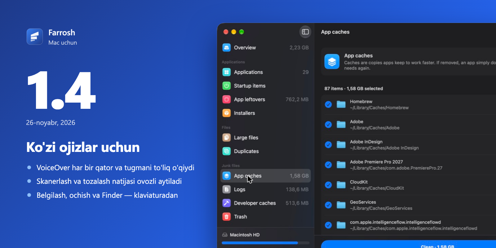
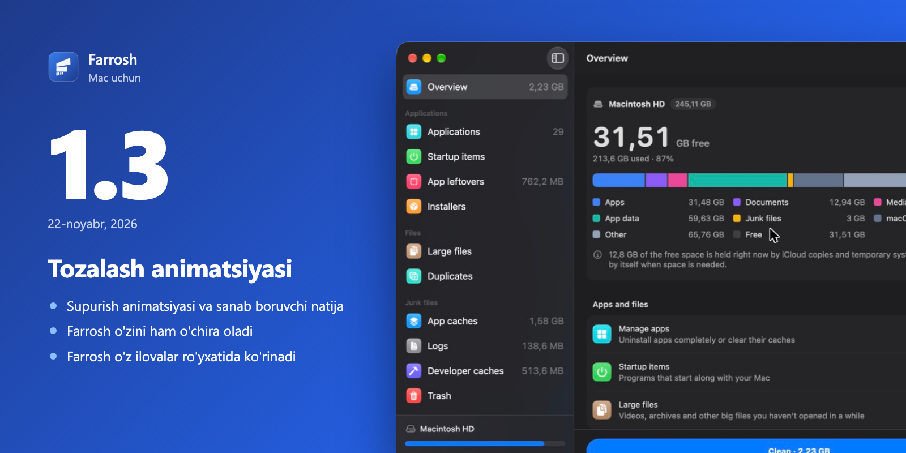
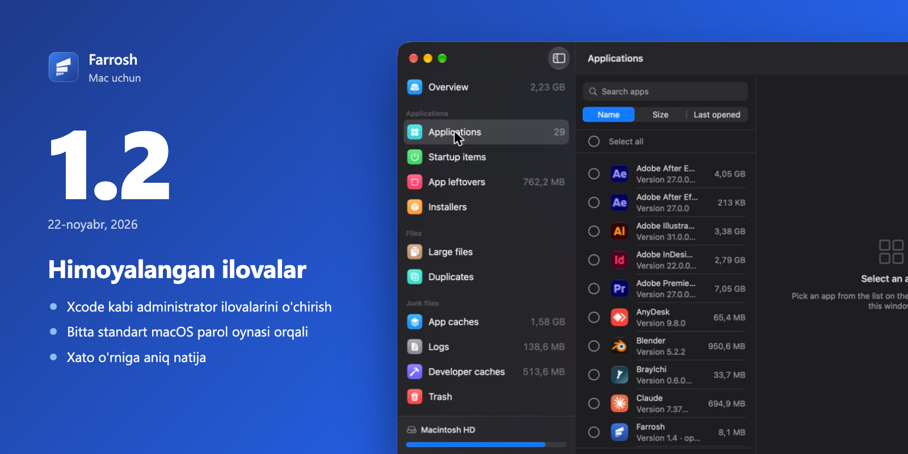
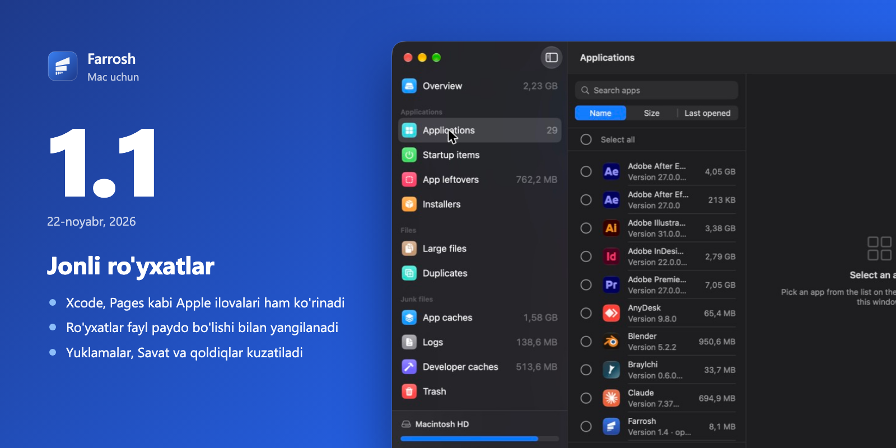
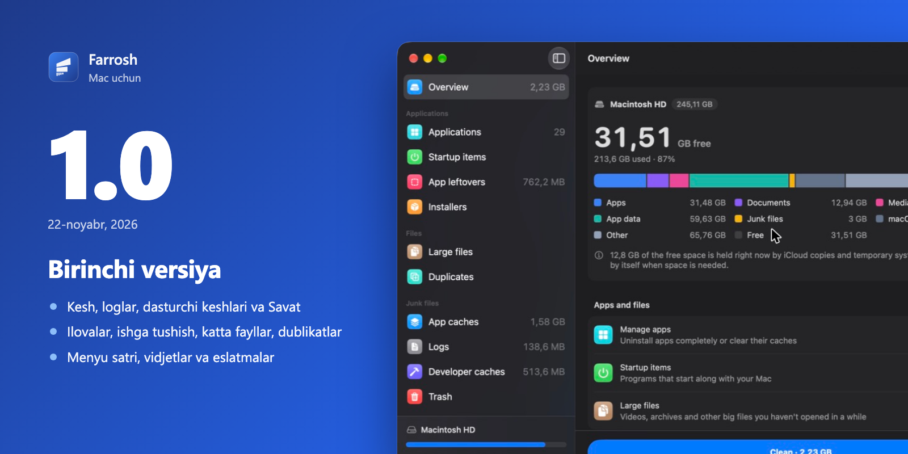

# Farrosh for Mac — versiyalar tarixi

Windows versiyasining tarixi: [windows/CHANGELOG.md](windows/CHANGELOG.md).

## 1.4 — 26-noyabr, 2026

**Ko'zi ojiz va ko'rishi past foydalanuvchilar uchun.**

- VoiceOver har bir qatorni bitta tugma sifatida o'qiydi: nomi, hajmi va holati bilan ("Homebrew, tanlangan, 428 MB").
- Bo'limlar, toifalar va ilovalar qatorlari VO + Probel bilan ochiladi; fayllarni belgilash ham shunday.
- Fayl qatorlarida «Finder'da ko'rsatish» VoiceOver amallari menyusida (VO + Cmd + Probel).
- Skanerlash tugagani, katta fayllar va dublikatlar topilgani, tozalash natijasi ovozli aytiladi.
- Almashtirgichlar va belgi tugmalarining nomlari bor ("Tozalashga qo'shish: Ilovalar keshi", "Belgilash: Blender").
- Bezak belgilari VoiceOver'da o'qilmaydi — ortiqcha gap yo'q.

## 1.3 — 22-noyabr, 2026

- Tozalash, ilova o'chirish va Savatga ko'chirish paytida supurish animatsiyasi. «Harakatni kamaytirish» yoqilgan bo'lsa, animatsiya o'chadi.
- Natija oynasida belgi va bo'shatilgan hajm sanab boriladi.
- Farrosh o'z ilovalar ro'yxatida ko'rinadi va o'zini o'chira oladi.

## 1.2 — 22-noyabr, 2026

- Xcode kabi administratorga tegishli ilovalar bitta standart macOS parol oynasi orqali o'chiriladi.

## 1.1 — 22-noyabr, 2026

- Foydalanuvchi o'rnatgan Apple ilovalari (Xcode, Pages…) ham ro'yxatda. Faqat tizim ilovalari yashiriladi.
- Ilovalar, katta fayllar, dublikatlar, o'rnatish fayllari, qoldiqlar va Savat ro'yxatlari fayllar o'zgarishi bilan o'zi yangilanadi.

## 1.0 — 22-noyabr, 2026

Birinchi versiya.

- Tozalash toifalari: ilovalar keshi, loglar, dasturchi keshlari, o'rnatish fayllari, o'chirilgan ilovalar qoldig'i, Savat.
- Ilovalarni qoldiqlari bilan o'chirish, ishga tushish ro'yxati, katta fayllar, dublikatlar.
- Menyu satridagi belgi, vidjetlar, joy kam qolganda ogohlantirish va tozalash eslatmasi.
- O'zbek, ingliz va rus tillari.

---

Bannerlarni qayta yaratish: `python3 docs/versiyalar/banner.py` (Google Chrome kerak).
