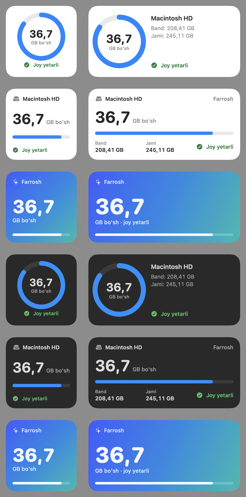

# Farrosh

### ⬇️ [Dasturni yuklab olish — Farrosh.zip](https://github.com/bahodirhasan/farrosh/releases/latest/download/Farrosh.zip)

*macOS uchun tayyor dastur. Yuklab oling → oching → Applications papkasiga ko'chiring → birinchi marta o'ng tugma → Ochish (Open).*

Mac'ni keraksiz fayllardan tozalaydigan dastur: kesh, loglar, eski o'rnatish fayllari, o'chirilgan ilovalar qoldig'i va boshqalar. Interfeys o'zbek, ingliz va rus tillarida.

*A macOS cleanup app (caches, logs, installers, leftovers of removed apps, large files, duplicates). Uzbek, English and Russian.*



## Yuklab olish

1. [**Releases**](../../releases/latest) bo'limidan `Farrosh.zip` ni yuklab oling va oching.
2. `Farrosh.app` ni **Applications** (Dasturlar) papkasiga ko'chiring.
3. Birinchi marta: belgini **o'ng tugma → Ochish (Open)** bilan oching. Dastur Apple tomonidan imzolanmagan, shuning uchun macOS bir marta so'raydi. Agar ochilmasa: **System Settings → Privacy & Security → Open Anyway**.

Talablar: macOS 13 (Ventura) yoki yangisi (widget uchun macOS 14). Apple Silicon va Intel Mac'larda ishlaydi.

## Imkoniyatlar

- **Tozalash toifalari** — ilovalar keshi, loglar, dasturchi keshlari (npm, pip, Homebrew, Xcode, simulyatorlar), yuklab olingan `.dmg`/`.pkg` fayllar, o'chirilgan ilovalar qoldig'i, Savat.
- **Katta fayllar** va **dublikatlar** — eng ko'p joy egallayotgan narsalarni topish.
- **Ilovalar** — ilovani barcha qoldiqlari bilan birga o'chirish.
- **Ishga tushish** — Mac yonganda o'zi ochiladigan dasturlar va fon xizmatlari.
- **Ish stoli widgeti** — diskda qancha bo'sh joy qolganini ko'rsatadi.

## Manbadan yig'ish

```bash
./build.sh
```

Natija: `build/Farrosh.app`. `Sources` — ilova, `Widget` — WidgetKit kengaytmasi, `Resources` — Info.plist va belgi skripti, `Logo` — logotip variantlari.
