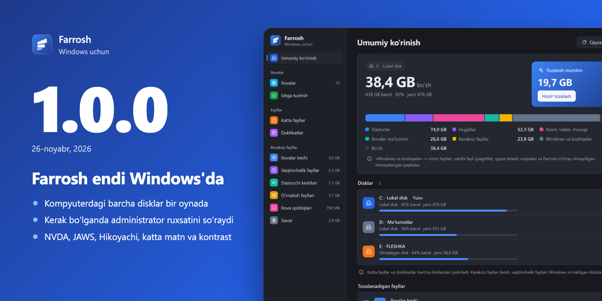
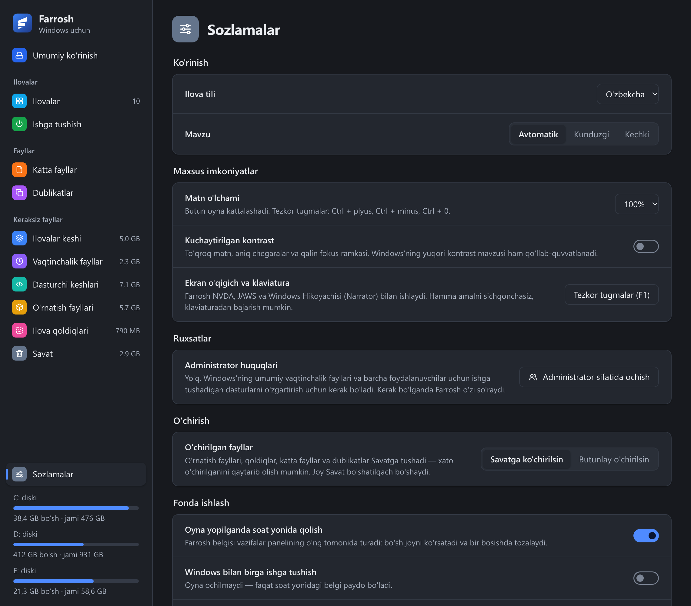

# Farrosh for Windows — versiyalar tarixi

Mac versiyasining tarixi: [../CHANGELOG.md](../CHANGELOG.md).

## 1.0.0 — 26-noyabr, 2026

Birinchi versiya. Windows 10 (1809+) va Windows 11, 64 bit.

**Tozalash**
- Ilovalar va brauzerlar keshi, vaqtinchalik fayllar, dasturchi keshlari, eski o'rnatish fayllari, o'chirilgan dasturlar qoldig'i, Savat.
- Dasturlarni bittalab yoki bir nechtasini birdan o'chirish, keyin AppData'dagi qoldiqlarini topish.
- Ishga tushadigan dasturlarni yoqish va o'chirish (Vazifalar menejeri usulida).
- Katta fayllar va dublikatlar.
- Soat yonidagi belgi: bo'sh joy, bir bosishda tozalash, ogohlantirish va eslatmalar.

**Barcha disklar**
- Kompyuterdagi hamma disklar (lokal, olinadigan, tarmoq) bitta oynada: nomi, hajmi, bo'sh joyi.
- Katta fayllar va dublikatlar barcha lokal va olinadigan disklardan qidiriladi.

**Ruxsatlar**
- Windows'ning umumiy vaqtinchalik fayllari yoki barcha foydalanuvchilar uchun ishga tushadigan dasturlar himoyalangan bo'lsa, Farrosh administrator ruxsatini so'raydi va rozilik berilsa o'zini shu huquq bilan qayta ochadi.
- Sozlamalar → Ruxsatlar: administrator sifatida istalgan payt ochish.

**Ko'zi ojiz va ko'rishi past foydalanuvchilar uchun**
- NVDA, JAWS va Windows Hikoyachisi (Narrator) bilan ishlaydi: har bir tugma, belgilash katakchasi va disk nomi bilan o'qiladi.
- Skanerlash tugagani, tozalash natijasi va xatolar ovozli aytiladi.
- Hamma amal klaviaturadan: Ctrl + 1…5 bo'limlar, F1 tezkor tugmalar ro'yxati, Ctrl + D disklarni o'qib berish.
- Matn o'lchami 100–200% (Ctrl + plyus / minus / 0).
- Kuchaytirilgan kontrast va Windows yuqori kontrast mavzulari.
- Sahifa almashganda fokus sarlavhaga o'tadi, qayta chizilganda klaviatura fokusi joyida qoladi.

